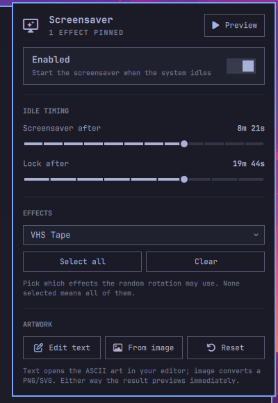

# Omarchy Screensaver Panel

[](https://github.com/brianirish/omarchy-screensaver-panel/actions/workflows/ci.yml)
[](https://github.com/brianirish/omarchy-screensaver-panel/actions/workflows/sync-upstream.yml)
[](LICENSE)
[](https://omarchyplugins.com/plugin.html?id=brianirish.screensaver)

**Made in Canada 🇨🇦**

> [!WARNING]
> **Effect pinning is broken on Omarchy 4.5 and later.** Omarchy 4.5 replaced
> the terminal screensaver with a native one, and the override described under
> [Enabling effect pinning](#enabling-effect-pinning) no longer runs, so every
> effect plays whatever you pin. The rest of the panel (on/off toggle, idle
> timing, artwork, Preview) isn't affected. A fix is on the way in
> [#3](https://github.com/brianirish/omarchy-screensaver-panel/pull/3); until
> it's released, there's no point installing the override on 4.5. The failing
> Sync upstream badge is the same issue.

A settings GUI for the [Omarchy](https://omarchy.org) screensaver — the knobs
that were previously config-file-and-CLI only, as a native shell panel.



Omarchy's screensaver (`ttfx` text effects over your ASCII branding) is
lovely, but tuning it means editing `shell.json` by hand and there's no way to
choose *which* effects play. This plugin adds a bar icon that opens a panel
with:

- **Enable/disable** toggle (right-click the bar icon for a quick toggle)
- **Idle timing** sliders for screensaver and lock delay, with snap-to presets
  (30s–30m / 1m–60m), applied instantly
- **Effect picker** — pin any subset of the 37 `ttfx` effects for the random
  rotation (searchable multi-select, Select all / Clear); empty selection
  means all effects, exactly like stock
- **Artwork** controls — edit the ASCII art as text, generate it from a
  PNG/SVG, or reset to the Omarchy logo
- **Preview** button

Everything is built from Omarchy's own UI kit, so it follows your theme.

## Install

The plugin is listed on the
[Omarchy Plugin Marketplace](https://omarchyplugins.com/plugin.html?id=brianirish.screensaver)
as `brianirish.screensaver`. Copy the install command from the listing, or run
it directly:

```bash
omarchy plugin add https://github.com/brianirish/omarchy-screensaver-panel.git --enable --yes
```

The widget lands in the bar's right section (move it with
`omarchy bar move brianirish.screensaver --section <left|center|right>`).

Everything except effect pinning works out of the box.

Requires Omarchy 4.5 or later, where the screensaver is the native
`omarchy-screensaver` overlay. On Omarchy 3.x, use
[v1.0.3](https://github.com/brianirish/omarchy-screensaver-panel/releases/tag/v1.0.3).

## Enabling effect pinning

Stock Omarchy plays a random pick from every effect. To honor the effects you
pin in the panel, install the bundled launcher wrapper, which passes them to
the screensaver as `--include-effects`:

```bash
sudo install -m 755 ~/.config/omarchy/plugins/brianirish.screensaver/extras/omarchy-launch-screensaver \
  /usr/local/bin/omarchy-launch-screensaver
```

`/usr/local/bin` comes before `/usr/bin` on PATH, so every launch (idle,
_System > Screensaver_, the panel's Preview) goes through the wrapper, which
then hands off to Omarchy's own launcher. Pinned effects are read from the
widget's `shell.json` entry at each launch, so changes apply to the next
screensaver without a relog. With nothing pinned, the wrapper changes nothing.
A pinned effect the installed screensaver doesn't know is skipped rather than
stopping the screensaver from starting.

> In `omarchy-dev-link` mode, Omarchy puts your checkout's `bin/` at the front
> of PATH, ahead of `/usr/local/bin`, and the wrapper is bypassed.

### Upgrading from 1.x

The 1.x override replaced the terminal screensaver script that Omarchy 4.5
removed, so it no longer runs. Remove it, and the PATH block 1.x asked you to
add to `~/.config/hypr/hyprland.lua` (Omarchy 4.5 no longer puts its own bin
directory ahead of `/usr/local/bin`), then install the wrapper as above:

```bash
sudo rm -f /usr/local/bin/omarchy-screensaver
```

### Keeping up with Omarchy

A daily workflow re-syncs the effect picker with the `ttfx` that Omarchy's
screensaver bundles and cuts a release when the list changes; pick that up
with `omarchy plugin update brianirish.screensaver`. It also watches Omarchy's
`omarchy-launch-screensaver`, and opens an issue for a human when that changes.
The wrapper only needs reinstalling when a release says so.

> The marketplace verifies one exact commit per listing, while `omarchy plugin
> add` and `omarchy plugin update` install the current `main`. After a release
> the listing may show *Update unverified* until the new commit is re-verified;
> the [listing page](https://omarchyplugins.com/plugin.html?id=brianirish.screensaver)
> names the verified commit if you want to check what you installed.

## Uninstall

```bash
omarchy plugin remove brianirish.screensaver
sudo rm -f /usr/local/bin/omarchy-launch-screensaver   # if you installed the wrapper
```

## License

[MIT](LICENSE)
